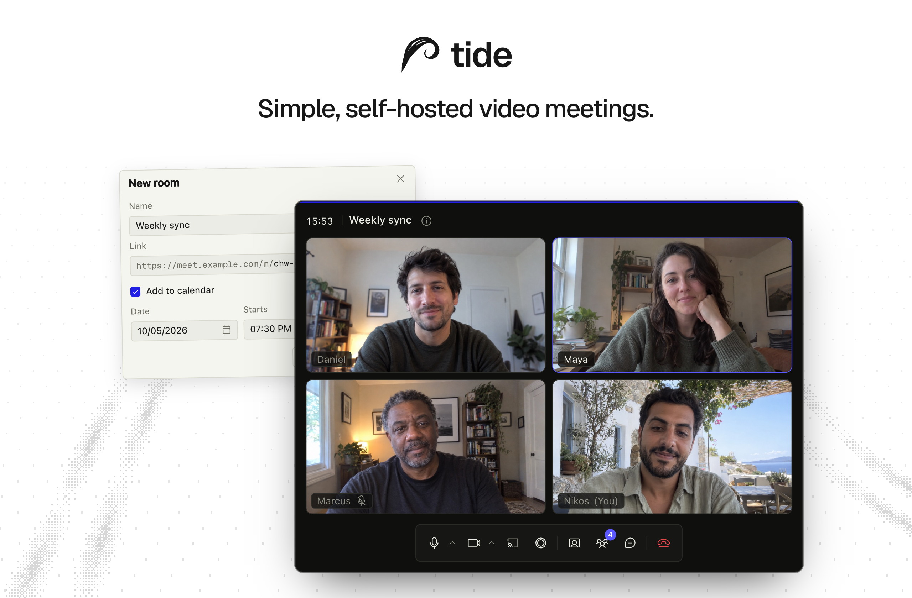
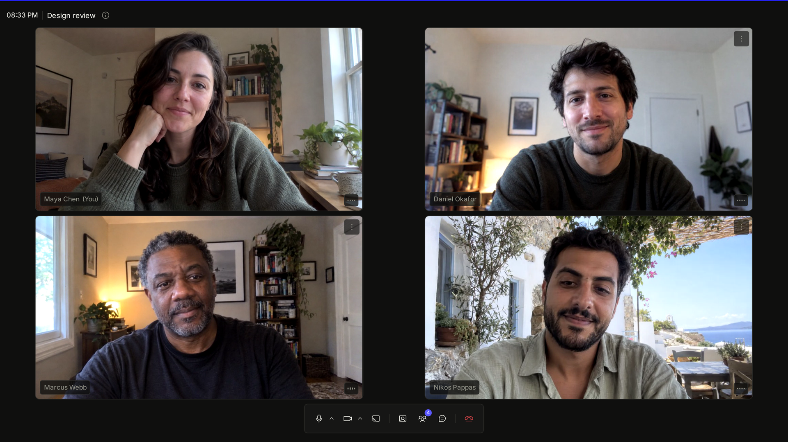

<p align="center">
  <a href="https://tide.convex.works">Website</a> ·
  <a href="https://demo.tide.convex.works">Demo</a> ·
  <a href="docs/user/guide.md">Guide</a> ·
  <a href="docs/operations/deployment.md">Deployment</a> ·
  <a href="docs/internals/architecture.md">Architecture</a>
</p>

tide is a self-hosted video meeting service. Its Go binary embeds the SvelteKit
web app and LiveKit media server. Optional recording uses LiveKit Egress,
Redis, and S3-compatible storage.

- Meeting links with custom slugs and downloadable calendar invites (`.ics`)
- Microphone, camera, screen sharing, device selection, and automatic reconnection
- Guest lobby with host controls to admit, deny, mute, remove, and end meetings
- Per-participant video hiding for the current viewer
- Ephemeral in-room chat
- Optional audio and video recording, with download and delete controls
- Optional transcripts of recordings, made by moil on the room owner's own
  computer (macOS, alpha; [how to use them](docs/user/guide.md#get-a-transcript)).
  No AI runs on the server
- [Bots](docs/user/bots.md): the room's owner can connect a
  program of their own, which hears each speaker and answers, in view of
  everyone



## Quickstart

On Linux with Docker:

```sh
docker run --rm --network host ghcr.io/convex-works/tide:0.1.2
```

The image is for linux/amd64 and linux/arm64. It uses the host's network
because browsers send media straight to tide on UDP 7882 and TCP 7881.

To build from source instead, you need Go 1.26.10 or later and Node 24 or
later. From the repository root:

```sh
npm ci --prefix web
make build
./bin/tide
```

Either way, with no `TIDE_*` environment variables set, tide runs in anonymous mode at
`http://localhost:8080`.

**Next:** open http://localhost:8080, choose **New**, then **Create & join**.
Open the meeting link in a private window to join as a guest, and admit the
guest from the host's People panel.

In anonymous mode, anyone who can reach the server can create a room. The
browser that creates it owns it. Unused rooms expire after 24 hours; restarting
tide clears every room.

## Deployment

Configuration selects the mode:

| Mode                     | Enabled by                | Room storage | Processes             |
| ------------------------ | ------------------------- | ------------ | --------------------- |
| Anonymous                | No OIDC issuer            | In memory    | tide                  |
| Signed in                | `TIDE_OIDC_ISSUER`        | SQLite       | tide                  |
| Signed in with recording | OIDC + `TIDE_S3_ENDPOINT` | SQLite       | tide + Egress + Redis |

Sign-in requires an OIDC provider and session and client secrets. Guests join
with a display name and do not need an account. Recording also requires an
S3-compatible bucket, storage credentials, and shared media and Redis secrets.

For production, serve tide behind an HTTPS proxy that forwards WebSocket
upgrades. Media reaches the server directly over UDP 7882, with TCP 7881 as a
fallback; there is no TURN relay on 443, so networks that allow only HTTPS out
get no media. The [deployment guide](docs/operations/deployment.md) covers the binary, Docker
Compose, Kubernetes, and all required configuration.

Restarting tide restarts its embedded media server and ends live meetings and
recordings. An [external media server](docs/operations/deployment.md#external-media-server)
can keep meetings running across a tide restart.

## Recording

Hosts can record audio as OGG or the meeting layout as MP4. Files go to the
configured S3-compatible bucket and appear in the room's recording list for
download or deletion.

Recording runs on the server and continues if the host closes their tab while
other participants remain. It stops when explicitly stopped or when the room
empties.

## Development

Install the web dependencies as in Quickstart, then run:

```sh
make dev     # the signed-in deployment with recording; needs Docker with Compose
make check   # must pass before committing
```

Open `http://localhost:5173` and sign in with `host@tide.dev` / `tide-dev`.
[Development](docs/operations/development.md) covers the rest, and
[docs/internals](docs/internals/architecture.md) explains how tide works and why.

## License

[MIT](LICENSE)
